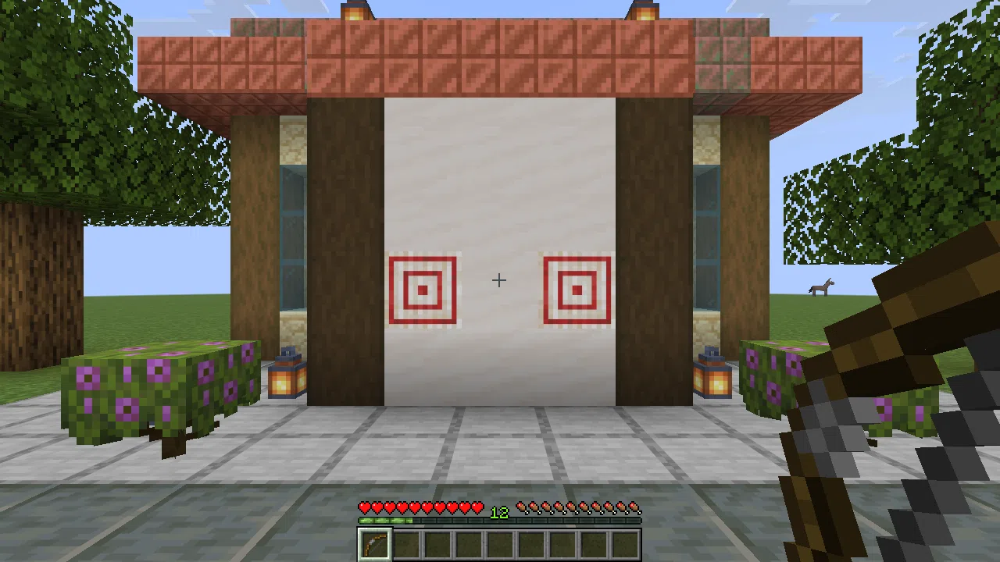
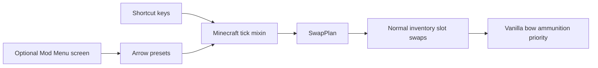

<div align="center">
<h1>Arrow Swap</h1>
<hr>
<p><strong>2 arrow presets in one place: rebindable shortcuts, inventory-based selection, vanilla bow priority.</strong></p>
<p>


</p>
<p>
<a href="https://github.com/hhhhhffd/ArrowSwap/releases"></a>

<a href="LICENSE"></a>
</p>
<p><a href="https://github.com/hhhhhffd/ArrowSwap/releases">Download</a> · <a href="#architecture">Architecture</a> · <a href="#build">Build</a></p>

</div>

## Overview

Arrow Swap is a client-side Minecraft mod that selects which arrow stack a vanilla bow uses first. Two shortcuts rearrange ammunition with ordinary inventory swaps; the mod does not aim, draw, or release the bow.

## Technical Stack

| Area | Technology | Version / role |
| --- | --- | --- |
| Runtime | Minecraft Java | 1.21.11 |
| Runtime | Fabric Loader | 0.18.4 or later; client only |
| Runtime | Java | 21 or later |
| Optional | Mod Menu | 17 or later, for configuration |
| Build | Fabric Loom / Gradle | 1.13.6 / 9.2.1 |

## Architecture



- Client mixins register key bindings and process them on ticks, without a server-side mod.
- `SwapPlan` separates slot selection from inventory actions; vanilla remains responsible for choosing ammunition.
- Mod Menu is a compile-only integration and optional at runtime; preset choices are stored in `config/arrowswap.json`.

## Project Structure

```text
.
├── build.gradle          # Loom build and dependencies
├── gradle.properties     # Minecraft and tool versions
├── gradle/wrapper/       # Gradle wrapper configuration
├── src/client/           # Client logic and mixins
├── src/main/             # Fabric metadata and resources
├── tests/                # Standalone swap-plan checks
└── docs/media/           # Demonstration
```

## Installation

1. Install Minecraft Java 1.21.11 with Fabric Loader 0.18.4 or later and Java 21 or later.
2. Download the JAR from [releases](https://github.com/hhhhhffd/ArrowSwap/releases) and place it in the client's `mods` folder.
3. Optionally install Mod Menu 17 or later to configure presets.

Fabric API and a server-side mod are not required. Mod Menu is a build-time compile-only dependency, not a required runtime dependency.

## Usage

| Shortcut | Default selection |
| --- | --- |
| G | Arrow A: Poison |
| V | Arrow B: Slowness |

Rebind them under **Options → Controls → Key Binds → Gameplay**. With optional **Mod Menu → Arrow Swap → Configure**, select A or B and choose a preset or an arrow stack already in your inventory. Stored selections include custom names and other item components, not just the item or potion. Click **Done** to save.

Use a shortcut with the bow ready but **not drawn**. If the chosen arrow is already first, nothing moves; otherwise a matching stack is moved to the position vanilla uses first. The action bar identifies the selected stack or reports that the arrow is missing.

> [!NOTE]
> Only one swap occurs per key press. The bow and a shield, totem or other non-arrow offhand item are left alone; a competing offhand arrow is swapped normally because held ammunition has priority. When a priority stack empties, vanilla may use other ammo; press the shortcut again to select another stack. Server plugins that replace vanilla ammo selection can ignore inventory priority.

## Build

Use Java 21 and the included Gradle wrapper:

```sh
./gradlew build
```

On Windows, use `gradlew.bat build`.

<details>
<summary>Standalone swap-plan checks</summary>

```sh
javac -d build/arrow-tests src/client/java/com/arrowswap/SwapPlan.java tests/SwapPlanTest.java
java -cp build/arrow-tests SwapPlanTest
```
</details>

## Links

- [Source](https://github.com/hhhhhffd/ArrowSwap)
- [Releases and downloads](https://github.com/hhhhhffd/ArrowSwap/releases)
- [Demo](docs/media/preview.webp)

## License

[MIT](LICENSE).
